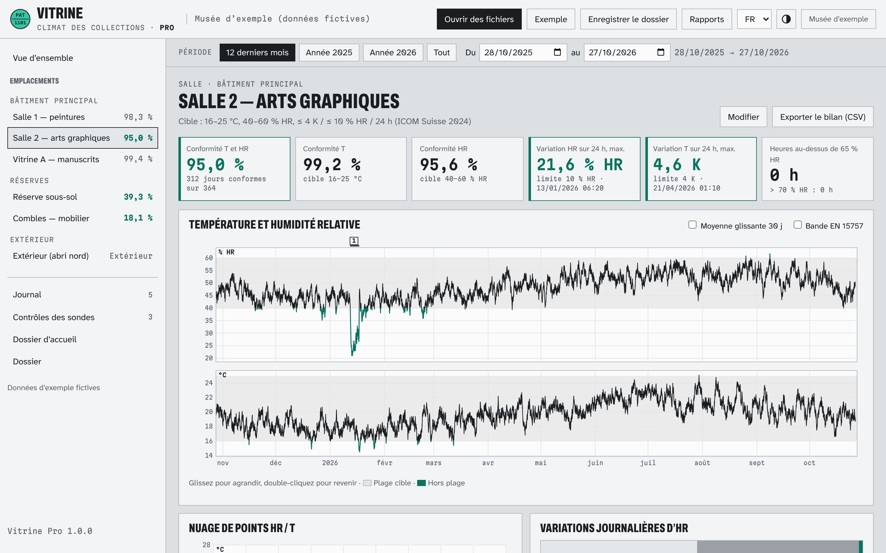

# Vitrine — climat des collections, édition gratuite

Lisez les exports de vos enregistreurs de température et d'humidité (**HOBO, Testo, Lascar EasyLog, Tinytag, T&D, Rotronic, Hanwell, Conserv** et tout CSV ou XLSX) et analysez-les selon les **recommandations ICOM Suisse 2024** et la méthode de l'**EN 15757**. Un seul fichier HTML : pas d'installation, pas de compte, aucune donnée envoyée sur le réseau. Interface en français, allemand et anglais.

*Capture de Vitrine Pro avec les données d'exemple (fictives). L'édition gratuite a la même analyse à l'écran pour un emplacement à la fois.*

## Utiliser

* En ligne, sans rien installer : [ouvrir Vitrine](https://consigne-studio.github.io/vitrine-gratuit/) — tout reste dans votre navigateur.
* Hors ligne : téléchargez [`vitrine-gratuit.html`](vitrine-gratuit.html) (bouton « Download raw file »), puis double-cliquez dessus. Des exports d'exemple sont dans [`exemples/`](exemples/).

## Ce que fait l'édition gratuite

* Lecture automatique des exports des marques courantes : séparateur, virgule décimale, encodage, dates françaises ou américaines, heure Unix, Fahrenheit, changement d'heure ; correspondance manuelle des colonnes pour les autres.
* Taux de conformité (température, humidité, les deux), jours conformes, variations sur 24 heures glissantes, classes de variation journalière, nuage HR / T.
* Moyenne glissante de 30 jours et bande de l'EN 15757, bilan mensuel exportable en CSV, point de rosée, heures au-dessus de 65 et 70 % HR, permanence relative.

Version 1.0.0. Usage gratuit, y compris professionnel ([licence](LICENSE)).

## Vitrine Pro

Vitrine Pro suit tous vos emplacements et produit les documents : **rapport annuel** de conservation préventive, **volet climatique des dossiers de prêt** et **dossier d'accueil (facility report)** rangé selon les modèles UKRG ou AAM, avec les réponses climatiques calculées depuis vos mesures, en PDF bilingue et en Word. Journal des événements, contrôles des sondes, archive ouverte en CSV. Licence annuelle par institution : [Vitrine Pro](https://consignestudio.gumroad.com/l/vitrine-pro).

## Support

Questions et signalements : support@consignestudio.fr, ou une issue sur ce dépôt.

Code écrit avec l'assistance d'un outil d'IA, relu et vérifié par des tests automatiques. Les marques citées appartiennent à leurs propriétaires ; Vitrine n'est affilié à aucun fabricant ni à l'ICOM.
